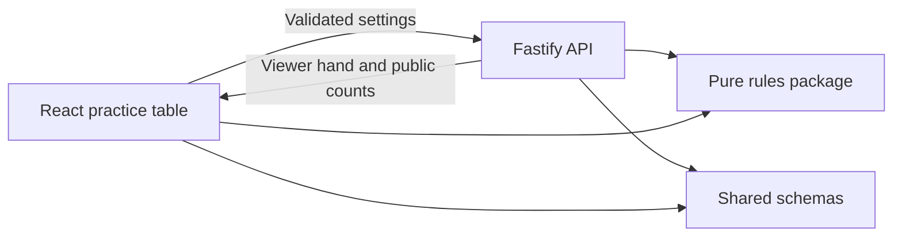

# Game Architecture

## Boundaries

The backend creates each practice shoe, shuffles with `crypto.randomInt`, partitions it, and returns only the viewer's hand. No full-shoe or opponent-hand endpoint exists. Practice previews are discarded after the response and are not matches. The browser's structure preview is advisory; future live commands must be validated by the server against authoritative state.

## Solo bot matches

`backend/src/bot-match.ts` connects declaration, kitty exchange, trick progression, and settlement. Injected time and shuffle choices make full matches reproducible in tests. Bots receive only their own hand, trump, and public lead components when choosing plays. Every bot and human move passes through `playCards`.

`bot-routes.ts` keeps sessions per application instance and projects only the human's hand, public declarations/plays/counts, and dealer-visible kitty cards. Random session IDs act as local practice tokens. Commands include a revision to reject stale or duplicate submissions. A 30-day idle expiry and 200-session cap bound storage. Private multiplayer rooms use separate per-player bearer tokens.

`match-store.ts` writes versioned snapshots to a private directory using a synced temporary file and atomic rename before publishing the new revision in memory. Each accepted bot command and bot declaration progress also records a bounded event with its revision, action, selected card IDs, and server timestamp. Startup restores snapshots and validates their public projection. Invalid files fail startup rather than silently losing a match. One server process owns a directory; multi-process coordination for solo matches and complete deterministic replay metadata remain future work. Unit tests use memory stores unless explicitly testing persistence. Docker mounts a named save volume.

The browser stores the session ID for explicit resume after refresh or server restart. It reveals server-validated bot plays sequentially and disables new commands during playback, with pause, speed, and skip controls. Reloading shows the latest saved state, not an unfinished animation. It pauses after completed tricks and settlements for review. History contains only played cards (100 recent tricks, 20 round summaries); no unplayed opponent cards or kitty contents are added. Dealing is immediate; server timestamps enforce declaration windows, and the user advances expired windows. Existing Vite/nginx proxy routes serve these endpoints without new dependencies.

## Determinism

Physical IDs distinguish copies from separate decks. Printed rank/suit determines set identity; effective category/power determines hierarchy. Powers are consecutive within a category and are not comparable between different non-trump suits. Singles do not form tractors.

The rules package accepts shuffle choices as an injected function and has no calls to `Math.random`, cryptographic APIs, network, or wall clocks. A future event log must record shuffle inputs/results and server timer events, and include `RULES_VERSION`. Do not expose those private events to clients.

`homogeneousStructure` recognizes a single whole structure. It deliberately returns `null` for mixed selections: canonical gamble decomposition and full follow validation are separate work. `advanceLevel` applies already-awarded advancement; it does not decide Jack reset or settle a round. The score explorer assumes the advancing team starts on the displayed level; it is not live match state.

## Infrastructure

Local development uses Vite's API proxy. Container mode uses nginx with a private backend service. Private rooms use authenticated HTTP polling. PostgreSQL is optional; previews and solo play do not require it.

### Transactional room storage

`RoomRepository` provides asynchronous reads, atomic creation, and a synchronous mutation callback inside `transact`. Callbacks receive a private draft and explicitly mark accepted state for saving. They must not perform external side effects or asynchronous work. File mode syncs and renames the snapshot before publishing its draft in memory, and retains the single-owner directory lock.

`PostgresRoomStore` locks the room row with `SELECT ... FOR UPDATE` **before** the callback authorizes and validates a command. An accepted mutation updates the snapshot and appends a private event in the same transaction. The database `revision` orders every mutation; the payload retains separate lobby and game revisions for the existing API. Rejected commands do not change either state or events. Invite-code creation uses a unique key and `ON CONFLICT DO NOTHING`, with code generation retried on collision. Startup serializes idempotent schema setup using a transaction-scoped advisory lock.

Room game commands may carry a UUID request ID. The room retains the last 200 accepted IDs and returns the current authorized projection when a retry repeats one, before checking the optimistic revision. This lets clients safely retry after a lost response without applying a move twice. Legacy callers may omit the field and receive a generated one; the browser always sends an ID.

Reads always query PostgreSQL; backend instances do not cache authoritative room state. The public polling API returns the authorized snapshot and up to 100 recent lobby events from that snapshot, never raw database events. Game events include action, acting seat, selected card IDs, game revision, and server time. Full deterministic replay still needs recorded shuffle/fallback outcomes and rules-version metadata.

Room expiry remains 24 hours from creation in every mode. Reads and commands reject expired rooms; a new room creation prunes expired database snapshots and their events. `DATABASE_URL` selects PostgreSQL; otherwise local file/memory mode remains available. JSON rooms are not migrated automatically. PostgreSQL sharing does not extend to solo bot sessions, which still need one process per save directory.

Tooling follows the official [Vite guide](https://vite.dev/guide/), [Fastify injection-testing guide](https://fastify.dev/docs/latest/Guides/Testing/), [Playwright web-server configuration](https://playwright.dev/docs/test-webserver), and [Compose application model](https://docs.docker.com/compose/intro/compose-application-model/).

### Shared solo bot policies

`backend/src/bot-policy.ts` defines leading, following, declaration, and burial decisions. The learned adapter in `backend/src/training/bot-policy.ts` is shared by live checkpoint loading and offline evaluation. Learned decisions use own-hand/public inputs and disable difficulty-dependent changes to their baseline preference. The heuristic Sharp adapter preserves the existing public-belief search and server-side other-hand validation for opening throws. This privileged input is not consumed by the learned adapter. Live declaration decisions receive only the cards dealt so far, matching simulator inputs.

`compare:live` evaluates the complete saved policy against Sharp with paired team assignments and fixed seeds, without modifying checkpoints or training. It measures bot-team performance, not interaction with a human partner.

Human playtest sessions retain a private opponent assignment, frozen champion model pair, fingerprint, and optional completed-parent match ID. The Standard partner is selected by team independently of the opponent. Public views reveal assignment only on terminal match settlement; replay and bot-behavior exports are all blocked while a playtest match is active, since a decision trace identifies the opponent as readily as a label. Continuations alternate the opponent and reuse an existing child on repeated requests, using the existing single-process snapshot store. Models are never projected into browser views or replay exports.
